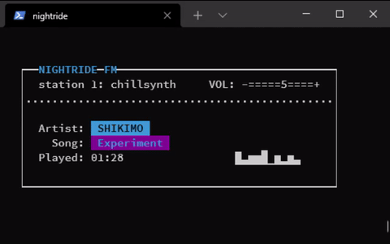

# Nightride FM player
Text-based player for [Nightride FM](https://nightride.fm/) synthwave radio.

  
In this screenshot I am running the player on [cool-retro-term](https://github.com/Swordfish90/cool-retro-term) to give it a bit more retro flavour.  
The player should work on the terminal emulator of your choice however.

## Code

[NightrideAPI.py](./NightrideAPI.py)  
Handles communication with the web audio stream and audio player.

[Radio.py](./Radio.py)  
Text interface for radio. Handles user input and communicates that to the API.

[AudioPlayer.py](./AudioPlayer.py)  
Handles audio player functionality using VLC

[LevelMeter.py](./LevelMeter.py)  
Measures the audio level of the stream for the VU meter

[settings.ini](./settings.ini)  
Various settings for the player

[paths.py](./paths.py)  
Locations of the settings and log files, so the player can be started from any directory.

## How to start
Developed to work on Linux. I might add support for different operating systems later :)

0. Install dependencies:

        sudo apt update && sudo apt install vlc
        
        python3 -m venv .venv
        .venv/bin/pip install -r requirements.txt

1. Run Radio.py:

        .venv/bin/python Radio.py

## How to use

The interface is modelled after MS-DOS era applications, with pull-down menus and dialog boxes.

Press **F10** to open the menu bar, or **Alt** and the red letter of a menu (e.g. **Alt-S** for *Station*).  
In the menus, use the arrow keys to move, **ENTER** to choose and **ESC** to close.  
Red letters in menu items are hotkeys.

Press **F1** to pop up a little info screen.

Press **F2** to open the station selector.  
Use arrow keys **UP** and **DOWN** to choose station, and press **ENTER** to confirm selection.  
Stations can also be changed using numbers **1** through **9** on the main screen,  
or with arrow keys **LEFT** and **RIGHT** to go to the previous or next station.

Press **PLUS** or **MINUS** to change volume, and **m** to mute.

Press **v** to enable/disable the VU meter. It shows the average level of the music for the left and right channels. A single lit segment marks the highest point the bar reached recently.

Press **Alt-X** or **F12** to quit.

## Notes

The player looks best in an 80 by 25 terminal, like in the old days. It needs at least 50 columns by 14 rows.  
The VU meter needs `parec` and `pactl`, which come with PulseAudio and PipeWire (package `pulseaudio-utils` on Debian and Ubuntu).  
It measures the music itself, so the volume setting doesn't change it, but it drops to zero while muted.  
On terminals with 256 colours it uses the original VGA palette, regardless of your terminal's colour theme.
