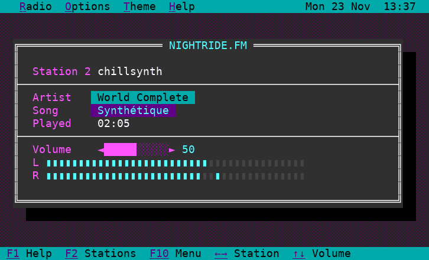

# Nightride

A terminal player for [Nightride FM](https://nightride.fm/) synthwave radio, in the style of the MS-DOS programs of the early 90s: pull-down menus, dialog boxes and drop shadows, in a terminal window.

This is an unofficial player, not made by Nightride FM. The music and the song info come from their public streams.

## Features

- All the Nightride FM stations: nightride, chillsynth, datawave, spacesynth, darksynth, horrorsynth and ebsm
- The song playing now, and the last 10 songs played. Station jingles and live shows are marked as such.
- Find the song on Bandcamp, Spotify, YouTube or Google. Spotify opens the song itself when the stream says which one it is.
- A stereo VU meter that measures the music itself
- Seven colour themes, from synthwave neon to a green CRT monitor
- Works with the keyboard and the mouse
- Linux and Windows, with a stand-alone version for Windows that needs nothing installed

## Install

### Windows

1. Download `nightride-setup.exe` from the [latest release](https://github.com/matiasraisanen/nightride/releases/latest).
2. Run it. It installs the player for you only, so it doesn't ask for administrator rights.
3. Start *Nightride player* from the Start menu.

Windows may say *Windows protected your PC*, because the installer isn't signed with a paid certificate. Click *More info*, then *Run anyway*. *Installed apps* in the Windows settings uninstalls it.

Or, to run it without installing, download `nightride-windows.zip`, unzip it anywhere, keep the files together, and double-click `nightride.exe`.

Python and VLC are included, so nothing else needs to be installed. It looks best in [Windows Terminal](https://aka.ms/terminal), the default terminal on Windows 11.

### Linux

The player needs [VLC](https://www.videolan.org/vlc/) for the audio, and [uv](https://docs.astral.sh/uv/) to install it.

1. Install VLC. On Debian and Ubuntu:

       sudo apt update && sudo apt install vlc

2. Install the player as the `nightride` command:

       uv tool install git+https://github.com/matiasraisanen/nightride

3. Run it from any terminal:

       nightride

### From source

To change the code, clone the repository and install it from the project folder with `--editable`. The command then runs the code in that folder, so changes show up without reinstalling:

    uv tool install --editable .

Or run it without installing, in a virtual environment:

    python3 -m venv .venv
    .venv/bin/pip install -r requirements.txt
    .venv/bin/python radio.py

On Windows, this needs VLC installed, and 64-bit VLC if your Python is 64-bit.

## How to use

Change the station with **←** **→** or **1**–**7**, and the volume with **↑** **↓**. **F10** opens the menus, and **F1** shows all the keys.

The user manual, [MANUAL.txt](./MANUAL.txt), tells the rest: the keys and menus, Recently played, Find this song, the mouse, the song info sync, Stream info, the settings and files, the command line options, and troubleshooting. In the player, *Help* → *User manual* opens it in your text editor. It comes with the Windows version too.

## Building the Windows version

On Windows, with [uv](https://docs.astral.sh/uv/) or 64-bit Python installed, in the project folder:

    powershell -ExecutionPolicy Bypass -File windows\build.ps1

It downloads VLC, checks it, and packs the player, Python and VLC together with [PyInstaller](https://pyinstaller.org/). The result is in `dist\nightride\`, and zipped as `dist\nightride-windows.zip`. With [Inno Setup 6](https://jrsoftware.org/isinfo.php) installed, it also makes the installer `dist\nightride-setup.exe` ([windows/nightride.iss](./windows/nightride.iss)).

GitHub builds them too, on a Windows machine ([.github/workflows/windows.yml](./.github/workflows/windows.yml)):

- **For a release:** set the version in `pyproject.toml`, then publish a release whose tag is that version, like `v2.0.0`. The build attaches `nightride-setup.exe` and `nightride-windows.zip` to the release.
- **To try a build:** pull requests are built, and *Actions* → *Windows build* → *Run workflow* builds any branch. The files are a download on the run.

The icon is [windows/nightride.svg](./windows/nightride.svg), and [windows/nightride-alt.svg](./windows/nightride-alt.svg) is a spare in other colours. After changing the icon, `python windows/make_icon.py` (with `cairosvg` and `pillow` installed) makes `windows/nightride.ico` again.

## Code

| File | |
|---|---|
| [radio.py](./radio.py) | The interface: drawing the screens, keys, mouse and menus |
| [screen.py](./screen.py) | Draws on the terminal, sending only what changed |
| [nightride_api.py](./nightride_api.py) | Reads the song info stream, and keeps the recently played songs |
| [audio_player.py](./audio_player.py) | Plays the audio streams with VLC, and reconnects when they drop |
| [level_meter.py](./level_meter.py) | Measures the audio level for the VU meter |
| [audio_streams.py](./audio_streams.py) | Finds the player's own audio stream in PulseAudio or PipeWire |
| [win_audio.py](./win_audio.py) | Finds the player's own audio session on Windows, and reads its level |
| [settings.py](./settings.py) | Reads and saves settings.ini, with defaults for anything missing |
| [paths.py](./paths.py) | Where the settings, log and history files go |
| [logger.py](./logger.py) | Logging, with old entries trimmed away |
| [windows/](./windows/) | The Windows build |

## License

[GPL-3.0](./LICENSE). The Windows version includes [VLC](https://www.videolan.org/), licensed under the GNU LGPL and GPL.
